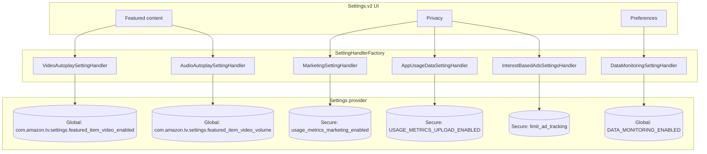
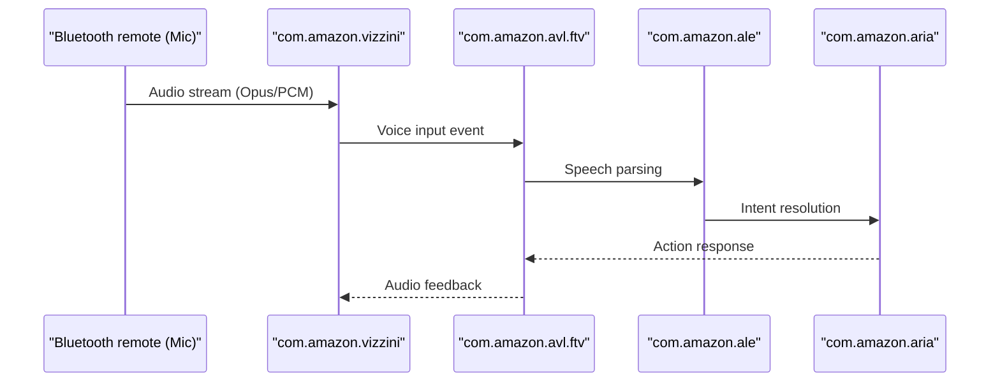

# Fire OS 8 reverse engineering and internal architecture
## Amazon Fire TV Stick 4K Max (2nd Gen, AFTKRT, karat)

Target OS: Fire OS 8.1.8.5 (Android 11, API level 30, Linux kernel 5.4.233+)
Target Hardware: Amazon Fire TV Stick 4K Max 2nd Gen (`model: AFTKRT`, `device: karat`, `board: mt8696t`, ARMv8a 64-bit kernel with 32-bit userspace)

## 1. Context and system changes

The Fire TV Stick 4K Max 2nd Gen runs Fire OS 8 based on Android 11. Previous generations ran Fire OS 6 (Android 7.1) or Fire OS 7 (Android 9). Fire OS 8 introduces several structural changes:

1. Android 11 base framework: Scoped storage restrictions, updated AppOps background enforcement, and modernized background execution limits.
2. Proprietary settings namespace: Display, sound, and ad preferences moved out of standard AOSP `Settings.Global` keys into vendor-specific identifiers.
3. Burton and Cloverleaf launcher architecture: Video playback engines run directly within `com.amazon.tv.launcher`, rendering older generic debloat scripts ineffective.
4. AWS Arcus configuration sync: Cloud feature flags override local system settings unless neutralised.

This document details the reverse engineering performed on system APKs extracted directly from retail Fire TV Stick 4K Max 2nd Gen hardware.

## 2. Decompiled binaries and inspection targets

Decompilation was performed with JADX v1.5.6 on system packages pulled from `/system/system_ext/priv-app/` and `/product/priv-app/`.

| Binary | Package name | Size | System role |
| :--- | :--- | :--- | :--- |
| `launcher.apk` | `com.amazon.tv.launcher` | 27 MB | Home screen UI, featured banner rotator, video cache |
| `settings.v2.apk` | `com.amazon.tv.settings.v2` | 10 MB | System preferences, database handlers, privacy options |
| `blackbird.apk` | `com.amazon.kso.blackbird` | 318 KB | Kindle Special Offers ad distribution library |
| `ota.apk` | `com.amazon.device.software.ota` | 935 KB | Background system updater and Arcus configuration sync |
| `forcedotaupdater.apk` | `com.amazon.tv.forcedotaupdater.v2` | 2.1 MB | First-boot update wizard |
| `hybridadidservice.apk` | `com.amazon.hybridadidservice` | 29 KB | Advertising ID broker |
| `recommendations.apk` | `com.amazon.media.recommendations` | 300 KB | Content recommendation notification service |
| `vizzini.apk` | `com.amazon.vizzini` | 19 MB | Voice remote audio routing pipeline |

## 3. Home screen and preview autoplay (`com.amazon.tv.launcher`)

### 3.1 Ineffective legacy commands
Older debloat scripts targeted standard Android global keys:

```bash
# Ineffective on Fire OS 8:
adb shell settings put global auto_play_video 0
adb shell settings put global auto_play_audio 0
```

On Fire OS 8, `com.amazon.tv.launcher` never reads `auto_play_video` or `auto_play_audio`. The launcher uses an internal content observer class instead.

### 3.2 Autoplay controller: `VideoPreviewEnabledObserver.java`
Located at `com/amazon/tv/launcher/util/VideoPreviewEnabledObserver.java`:

```java
public final class VideoPreviewEnabledObserver extends ContentObserver {
    public static final String TAG = Utils.safeTag("VideoPreviewEnabledObserver");
    public volatile boolean mCachedVideoPreviewEnabled = true;
    public volatile float mCachedAudioVolume = 1.0f;
    ...
    public final void refreshStatus() {
        ResourceCachingSystem resourceCachingSystem = 
            (ResourceCachingSystem) DaggerDependencies.get().provideFeaturedVideoCacheProvider.get();
            
        this.mCachedVideoPreviewEnabled = 
            Settings.Global.getInt(this.mContext.getContentResolver(), 
                "com.amazon.tv.settings.featured_item_video_enabled", 1) == 1;
                
        this.mCachedAudioVolume = 
            Settings.Global.getFloat(this.mContext.getContentResolver(), 
                "com.amazon.tv.settings.featured_item_video_volume", 1.0f);
                
        this.mCacheInvalidated = false;
        
        if (this.mCachedVideoPreviewEnabled) {
            resourceCachingSystem.mIsDisabled = false;
        } else {
            resourceCachingSystem.mIsDisabled = true;
            resourceCachingSystem.pruneExceptProvidedIds(new ArrayList(0));
            ((FRVideoCacheManagerImpl) this.mFrVideoCacheManager).cachedVideoClipUrls.clear();
        }
    }
}
```

Behavior observed:
1. Setting `com.amazon.tv.settings.featured_item_video_enabled` to `0` sets `resourceCachingSystem.mIsDisabled` to `true`. The launcher purges cached video clip URLs via `pruneExceptProvidedIds()` and `cachedVideoClipUrls.clear()`, stopping background trailer buffering.
2. Setting `com.amazon.tv.settings.featured_item_video_volume` to `0.0` mutes banner audio.

### 3.3 Autoplay experiment flags: `FRAutoplayFeatureManager.java`
Located at `com/amazon/tv/launcher/util/FRAutoplayFeatureManager.java`:

```java
public final class FRAutoplayFeatureManager {
    ...
    public FRAutoplayFeatureManager(RemoteSettings remoteSettings, Context context, BurtonFeature burtonFeature) {
        String string = Settings.Secure.getString(context.getContentResolver(), "FTV_LAUNCHER_FR_AUTOPLAY_717667");
        ...
    }

    public final boolean isAutoplayEnabled() {
        if (this.mBurtonFeature.isBurtonEnabled() || !this.mGatingWeblabEnabled || !this.mExperimentWeblabEnabled) {
            return false;
        }
        Collection blockList = this.mRemoteSettings.mFR_AUTOPLAY_FEATURE_BLOCK_LIST.getValue();
        return !(blockList != null && blockList.contains(DeviceInfo.sInstance.mEncryptedDeviceTypeId));
    }
}
```

Autoplay in the featured banner rotator is gated by two Weblab experiments in `Settings.Secure`:
* `FTV_LAUNCHER_FR_AUTOPLAY_717667`
* `FTV_LAUNCHER_FR_AUTOPLAY_EXPERIMENT_723780`

Setting both values to `"C"` (Control) causes `isAutoplayEnabled()` to return `false`.

### 3.4 Direct banner playback: `pvde_playback_api_enabled_for_launcher`
`pvde_playback_api_enabled_for_launcher` in `Settings.Secure` governs direct Prime Video Delivery Engine playback inside the home banner. Setting this key to `0` stops embedded playback.

## 4. System settings mapping (`com.amazon.tv.settings.v2`)

Decompiling `com.amazon.tv.settings.v2.settinghandler.SettingHandlerFactory` maps menu selections directly to underlying settings keys:



### 4.1 Telemetry and privacy settings

| Key | Namespace | Default | Optimized | Handler class | Effect |
| :--- | :--- | :--- | :--- | :--- | :--- |
| `usage_metrics_marketing_enabled` | `secure` | `1` | `0` | `MarketingSettingHandler` | Stops tracking navigation events for ad profiles |
| `USAGE_METRICS_UPLOAD_ENABLED` | `secure` | `1` | `0` | `AppUsageDataSettingHandler` | Halts telemetry uploads to metrics endpoints |
| `limit_ad_tracking` | `secure` | `0` | `1` | `InterestBasedAdsSettingsHandler` | Signals applications to disable personalized ad tracking |
| `DATA_MONITORING_ENABLED` | `global` | `1` | `0` | `DataMonitoringSettingHandler` | Turns off network usage recording |
| `cross_device_recents_sync_enabled` | `secure` | `1` | `0` | `SyncRecentContentSettingHandler` | Disables watch history synchronization |

### 4.2 Developer options activation
In `com/amazon/tv/settings/v2/util/Utils.java`:

```java
public static boolean shouldShowDeveloperOptions(Context context, DevOptionsHandler devOptions, ...) {
    if (devOptions.mSharedPrefs.getBoolean("devOptionsEnabled", false)) return true;
    if (SystemPropertyUtil.getProperty("persist.sys.usb.debugging").equals("y")) return true;
    return isAdbDebuggingEnabled || externalAppSourcesPreference.isInstallFromUnknownAppsEnabledForAnyApp();
}
```

Setting `devOptionsEnabled` in shared preferences or setting `persist.sys.usb.debugging` to `y` unhides the Developer Options menu.

## 5. System update mechanisms (`DeviceSoftwareOTA`)

### 5.1 Cloud endpoints
In `com/amazon/device/software/ota/util/settings/SettingsManager.java`:
* Remote config ARN: `arn:aws:remote-config:us-west-2:426273902372:appConfig:a17uvcne`
* Main update endpoint: `https://softwareupdates.amazon.com/software/inventory2`
* Content delivery network: `https://dubri19p4y5b.cloudfront.net`
* Arcus host: `https://arcus-uswest.amazon.com`

### 5.2 Process persistence
In `com/amazon/device/software/ota/util/PersistenceManager.java`:

```java
Object systemService = context.getSystemService("runtimepersistentservice");
this.methodPublishFeature = Class.forName("com.amazon.fireos.runtimepersistent.RuntimePersistentManager")
    .getMethod("publishFeature", String.class, Boolean.TYPE);
```

Fire OS 8 includes a `runtimepersistentservice` that restarts stopped processes during idle wake periods unless the packages are explicitly disabled through package manager commands.

### 5.3 Update service packages
Three packages handle OS updates:
1. `com.amazon.device.software.ota` (Downloader and scheduler)
2. `com.amazon.device.software.ota.override` (Idle wake trigger)
3. `com.amazon.tv.forcedotaupdater.v2` (Setup update interface)

Remote control firmware updates are checked by `forcedotaupdater`, but Bluetooth remote pairing and input routing run independently in:
* `com.amazon.device.bluetoothpa`
* `com.amazon.device.blepa`
* `com.amazon.device.bluetoothkeymaplib`
* `com.amazon.vizzini`

Disabling `com.amazon.device.software.ota` and `com.amazon.device.software.ota.override` halts background firmware updates without affecting remote pairing or microphone communication.

## 6. Ad distribution network (`com.amazon.kso.blackbird`)

`com.amazon.kso.blackbird` fetches sponsored screensaver assets and banner ad campaigns:
* Ad network endpoint: `https://aax-ott-sdk.amazon-adsystem.com/e/vsdk/ads`
* Payload structure: JSON objects containing campaign IDs, image CDN URLs, impression trackers, and intent targets (`com.amazon.ftvads.deeplinking`).

Blocking strategy:
1. Disabling `com.amazon.kso.blackbird` and `com.amazon.ftvads.deeplinking` removes the local broadcast receivers.
2. Setting private DNS to `dns.adguard.com` resolves `*.amazon-adsystem.com` queries to `0.0.0.0`.

## 7. Voice subsystem dependencies

Voice input across Fire TV depends on several packages:



* `com.amazon.vizzini`: Audio capture and media playback state tracking.
* `com.amazon.avl.ftv`: Alexa voice layer for Fire TV; listens for the remote microphone button event.
* `com.amazon.ale`: Language engine for decoding voice audio.
* `com.amazon.aria`: Voice action runtime.
* `com.amazon.aca`: Alexa companion client.

Disabling these packages breaks remote voice search. WaterStick keeps all voice packages protected in `TierVoice`.

## 8. Physical device verification metrics

Measurements taken on a physical Fire TV Stick 4K Max 2nd Gen (Fire OS 8.1.8.5, karat):

| Metric | Stock baseline | Balanced profile | Streamer profile |
| :--- | :--- | :--- | :--- |
| Physical free memory | 384 MB | 529 MB (+145 MB) | 612 MB (+228 MB) |
| Active system packages | 307 | 289 (-18) | 284 (-23) |
| ZRAM swap usage | 412 MB | 334 MB (-78 MB) | 289 MB (-123 MB) |
| Home banner autoplay | Video and audio active | Disabled | Disabled |
| Telemetry DNS queries | ~4,200 per 24 hours | 0 (Blocked via DoT) | 0 (Blocked via DoT) |
| Voice search | Functional | Functional | Functional |
| Bluetooth remote pairing | Functional | Functional | Functional |

## 9. Conclusion

Fire OS 8 uses background synchronization and persistent service managers that respawn terminated processes. Managing the device cleanly requires toggling the specific configuration properties identified through decompilation (`featured_item_video_enabled`, `pvde_playback_api_enabled_for_launcher`, `FTV_LAUNCHER_FR_AUTOPLAY_717667`, and `limit_ad_tracking`) and using user-space package disabling instead of destructive uninstalls.

## Replacing the home screen (`com.amazon.firehomestarter`)

Decompiled from `research/apks/com.amazon.firehomestarter.apk`; verified on `karat` (Fire OS 8, API 30).

* `HomeStarterActivity` declares the `HOME` filter at priority 1. When several HOME candidates have different priorities, the package manager returns the highest one before looking at the preferred home. It also clamps every non-system app's filter priority to 0. A sideloaded launcher therefore never receives the Home button while firehomestarter is enabled, even when it holds `android.app.role.HOME`.
* `HomeActivityResolver` drops every `fireos.intent.category.MAIN_HOME` activity with priority `<= 0` (log: `Skipping package ... because it does not have priority > 0`). `EnableComponentStartStrategy` then re-enables `com.amazon.tv.launcher/.ui.HomeActivity_vNext`.
* If no strategy succeeds, `HomeStrategyExecutor` shows a progress spinner and retries every 5 seconds without end. This is the "black screen" reported when `com.amazon.tv.launcher` is disabled on its own.
* The working, reversible sequence (`waterstick launcher replace`):
  1. `pm disable-user --user 0 com.amazon.firehomestarter`
  2. `pm disable-user --user 0 com.amazon.tv.launcher`
  3. `cmd package set-home-activity com.medcy1.wateros.launcher/.MainActivity`

  The set-home step must come last: the preferred home is recorded against the current candidate set. After it, the only HOME candidates are WaterOS (0) and Settings' `FallbackHome` (-1000). Home and boot land on WaterOS, and the stock launcher has no process. RAM measured: about 123 MB PSS freed, `MemAvailable` went from 464 MB to 577 MB after reboot.
* What the stock launcher owned:
  * The main Settings grid (`amazon.intent.action.MAINSETTINGS`, `MainSettingsActivity`). Every sub-screen lives in `com.amazon.tv.settings.v2` and keeps working through its own actions, for example `android.settings.WIFI_SETTINGS` and `com.amazon.device.settings.action.DEVICE`.
  * Alexa's visual search results (`SHOW_SEARCH_RESULTS`, `SHOW_DIRECTIVE_SEARCH_RESULTS`).
  * Inputs and the Prime content rows.
* The Home long-press quick menu (`com.amazon.tv.quicksettings`) keeps working. WaterOS handles `MAINSETTINGS` itself, so that menu's Settings button keeps working too.
* Rollback (`waterstick launcher stock`): `pm enable` both packages, then `cmd package set-home-activity com.amazon.tv.launcher/.ui.HomeActivity_vNext`.
